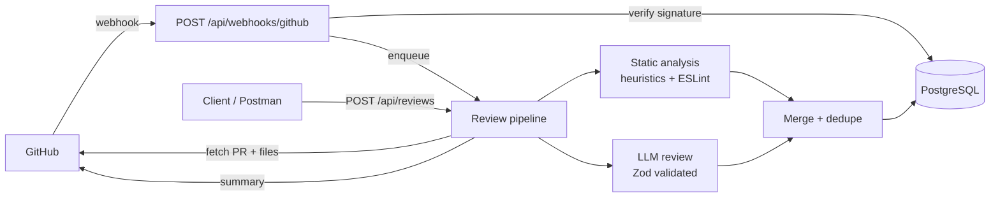

# PatchPilot API

AI-powered code review backend for open-source maintainers. PatchPilot reviews a
GitHub pull request, flags potential bugs, security issues, performance problems
and missing tests, suggests fixes, and publishes a review summary back to GitHub.

This repository contains the **backend only**. Authentication is intentionally out
of scope, so this initial version is for **local development or a trusted demo
environment** and must not be exposed as a public multi-user service.

---

## Features

- GitHub App integration (installation tokens, repository + PR access)
- Webhook receiver with HMAC-SHA256 verification and delivery idempotency
- In-process review pipeline with `QUEUED → RUNNING → COMPLETED | FAILED`
- Static analysis with ESLint on changed JavaScript/TypeScript files
- Heuristic scanners for secrets, injection patterns, TLS disabling, conflict
  markers, unsafe CI workflows and more
- Test-gap detection for source changes without test changes
- LLM review through one OpenAI-compatible provider, validated with Zod
- Deduplication of findings across static analysis and AI
- Suggested fixes (`suggestedFix`) returned with every finding
- Review summary publishing as a GitHub PR review (no approval/blocking)
- PostgreSQL persistence through Prisma with migrations
- Rate limiting, Helmet, CORS, request size limits, centralised errors
- Suggested fixes are never executed, committed, pushed or merged

---

## Tech stack

| Concern | Choice |
| --- | --- |
| Runtime | Node.js 22.5+ (ES modules, JavaScript) |
| HTTP | Express 5 |
| Database | PostgreSQL 17 (Docker Compose) |
| ORM | Prisma 6 |
| Validation | Zod |
| GitHub | `@octokit/rest` + `@octokit/auth-app` |
| Static analysis | ESLint 10 (Node API) |
| Security | Helmet, express-rate-limit, `node:crypto` |
| Tests | Node.js built-in test runner (`node:test`) |

---

## Architecture



The review job runs in-process and asynchronously. On startup, reviews left in
`QUEUED` or `RUNNING` from a previous crash are marked `FAILED`, because in-process
jobs cannot survive a restart.

---

## Project structure

```text
.
├── config/
│   ├── env.js                 # Zod-validated environment configuration
│   └── prisma.js              # Prisma client singleton
├── prisma/
│   ├── schema.prisma
│   └── migrations/
├── src/
│   ├── app.js                 # Express app (Helmet, CORS, JSON, rate limit)
│   ├── server.js              # Startup, interrupted-review reconciliation
│   ├── controllers/
│   │   ├── github.controller.js
│   │   ├── review.controller.js
│   │   └── webhook.controller.js
│   ├── middleware/
│   │   └── error.middleware.js
│   ├── routes/
│   │   ├── github.routes.js
│   │   ├── review.routes.js
│   │   └── webhook.routes.js
│   ├── services/
│   │   ├── github.service.js
│   │   ├── review.service.js
│   │   ├── analysis.service.js
│   │   └── ai.service.js
│   ├── scripts/
│   │   └── seed.js
│   ├── utils/
│   │   └── response.js
│   └── validators/
│       ├── github.validator.js
│       └── review.validator.js
├── tests/
├── docker-compose.yml
├── eslint.config.js
├── postman/
│   └── PatchPilot.postman_collection.json
├── .env.example
└── package.json
```

---

## Quick start

### Prerequisites

- Node.js 22.5 or newer
- Docker Desktop (or Docker Engine + Compose)
- A GitHub App if you want real pull-request reviews (optional for demos)

### 1. Install dependencies

```bash
npm install
```

### 2. Configure environment

```bash
cp .env.example .env
```

Set `POSTGRES_PORT` and `DATABASE_URL` to the same port. The example uses `5432`;
if that port is busy (common when another Postgres container is running), use
something like `5434` in both places.

### 3. Start PostgreSQL

```bash
docker compose up -d
docker compose ps
```

Wait for the container health check to report `healthy`.

### 4. Run migrations

```bash
npm run db:migrate       # creates prisma/migrations if needed
# or, in CI/deployment:
npm run db:migrate:deploy
```

### 5. Start the API

```bash
npm run dev
```

The API listens on `http://localhost:4000`.

### 6. Load demo data (optional)

```bash
npm run db:seed
```

This inserts a demo repository, pull request and a completed review with four
findings, without needing a GitHub App.

```bash
curl http://localhost:4000/api/reviews
curl http://localhost:4000/api/reviews/00000000-0000-4000-8000-000000000001
```

---

## Docker commands

| Task | Command |
| --- | --- |
| Start database | `docker compose up -d` |
| Stop database | `docker compose down` |
| Inspect status | `docker compose ps` |
| Database logs | `docker compose logs -f postgres` |
| Open `psql` | `docker compose exec postgres psql -U patchpilot -d patchpilot` |
| Reset schema only | `npm run db:reset` |
| Destroy all data (volume) | `docker compose down -v` |

The named volume is `pgdata`, so `docker compose down -v` deletes local data
permanently.

---

## Prisma commands

| Task | Command |
| --- | --- |
| Create + apply a migration | `npm run db:migrate -- --name change_name` |
| Apply migrations (production) | `npm run db:migrate:deploy` |
| Regenerate the client | `npm run db:generate` |
| Browse data | `npm run db:studio` |
| Reset database + migrations | `npm run db:reset` |

---

## GitHub App setup

1. Open **GitHub → Settings → Developer settings → GitHub Apps → New GitHub App**.
2. Set the webhook URL to your public endpoint, e.g.
   `https://your-subdomain.ngrok.app/api/webhooks/github` (use ngrok, Cloudflare
   Tunnel or `smee.io` while developing locally).
3. Set a **webhook secret** and put the same value in `GITHUB_WEBHOOK_SECRET`.
4. Repository permissions:
   - **Contents:** Read-only (needed to fetch changed file contents for ESLint)
   - **Pull requests:** Read and write (read the PR, post the review summary)
   - **Metadata:** Read-only (automatic)
5. Subscribe to events:
   - `Pull request`
   - `Installation`
   - `Installation repositories`
6. Generate and download a private key (`.pem`).
7. Install the app on your repository, then copy the installation id from the
   installation URL (`.../installations/12345678`) into `GITHUB_INSTALLATION_ID`.
8. Fill in `.env`:

```dotenv
GITHUB_APP_ID=123456
GITHUB_INSTALLATION_ID=12345678
GITHUB_APP_SLUG=your-app-slug
GITHUB_WEBHOOK_SECRET=your-webhook-secret
GITHUB_APP_PRIVATE_KEY_PATH=C:\path\to\your\github-app-private-key.pem
```
The app loads the private key from `GITHUB_APP_PRIVATE_KEY_PATH`. Paths may be
absolute or relative to the project directory. The inline
`GITHUB_APP_PRIVATE_KEY` option is still supported, but never commit `.env` or
the `.pem` file.

If the App lacks `pull_requests: write`, the review still completes and the
publishing error is stored separately in `summaryPublishError`; the review is
not marked failed.

---

## Environment variables

| Variable | Required | Default | Purpose |
| --- | --- | --- | --- |
| `NODE_ENV` | no | `development` | `development`, `production`, `test` |
| `PORT` | no | `4000` | HTTP port |
| `DATABASE_URL` | yes | example URL | PostgreSQL connection string |
| `POSTGRES_DB` | no | `patchpilot` | Compose database name |
| `POSTGRES_USER` | no | `patchpilot` | Compose database user |
| `POSTGRES_PASSWORD` | no | `patchpilot` | Compose database password |
| `POSTGRES_PORT` | no | `5432` | Host port mapped to Postgres |
| `FRONTEND_URL` | no | `http://localhost:3000` | Allowed CORS origin(s), comma separated |
| `GITHUB_APP_ID` | for GitHub | — | GitHub App id |
| `GITHUB_APP_PRIVATE_KEY` | for GitHub | — | App private key (PEM or `\n` escaped) |
| `GITHUB_WEBHOOK_SECRET` | for GitHub | — | HMAC secret for webhooks |
| `GITHUB_INSTALLATION_ID` | for GitHub | — | Installation id |
| `GITHUB_APP_SLUG` | no | `patchpilot` | Used by the install redirect |
| `LLM_API_KEY` | no | — | Enables AI review when set |
| `LLM_MODEL` | no | `gpt-4o-mini` | Model name |
| `LLM_BASE_URL` | no | `https://api.openai.com/v1` | OpenAI-compatible endpoint |
| `LLM_TIMEOUT_MS` | no | `60000` | AI request timeout |
| `LLM_MAX_DIFF_CHARS` | no | `120000` | Diff characters sent to the model |

Environment is validated with Zod at startup; invalid values stop the process.

---

## API reference

| Method | Path | Description |
| --- | --- | --- |
| `GET` | `/health` | Liveness + database check |
| `GET` | `/api/github/install` | Redirect to the GitHub App installation page |
| `GET` | `/api/github/repositories` | Repositories accessible to the installation |
| `GET` | `/api/github/repositories/:owner/:repo/pulls` | List pull requests |
| `GET` | `/api/github/repositories/:owner/:repo/pulls/:number` | Pull request details |
| `POST` | `/api/reviews` | Start a review (202 + review id) |
| `GET` | `/api/reviews` | Paginated review list |
| `GET` | `/api/reviews/:id` | Review details |
| `GET` | `/api/reviews/:id/findings` | Findings with evidence and suggested fixes |
| `GET` | `/api/reviews/:id/status` | Status + per-severity counts |
| `POST` | `/api/reviews/:id/publish` | Re-post the summary to GitHub |
| `POST` | `/api/webhooks/github` | GitHub webhook receiver |

### Start a review

```bash
curl -X POST http://localhost:4000/api/reviews \
  -H "Content-Type: application/json" \
  -d '{"owner":"octocat","repo":"hello-world","pullNumber":42}'
```

Response `202 Accepted`:

```json
{ "id": "3f8f0a52-6d2e-4a3e-9f5d-2a3c7b1e9d11" }
```

### Poll status

```bash
curl http://localhost:4000/api/reviews/<review-id>/status
```

```json
{
  "id": "3f8f0a52-...",
  "status": "COMPLETED",
  "summary": "PatchPilot reviewed ...",
  "findingCounts": { "CRITICAL": 1, "HIGH": 2, "MEDIUM": 1 }
}
```

### Findings

```bash
curl http://localhost:4000/api/reviews/<review-id>/findings
```

Each finding contains `title`, `description`, `severity`, `category`, `filePath`,
`startLine`, `endLine`, `evidence`, `suggestedFix` and `confidence`.

### Pagination and filters

```bash
curl "http://localhost:4000/api/reviews?limit=10&offset=0&status=COMPLETED"
```

`limit` is 1–100, `offset` is ≥ 0, and `repositoryId` can filter by repository.

### Publish a summary again

```bash
curl -X POST http://localhost:4000/api/reviews/<review-id>/publish
```

Publishing errors are returned as `{ "published": false, "error": "..." }` and do
not change the review status.

### Postman

Import `postman/PatchPilot.postman_collection.json` and set the `baseUrl`
variable (default `http://localhost:4000`). The collection contains every
endpoint above, including sample review-creation bodies.

---

## Review lifecycle

1. **Create** — `POST /api/reviews` fetches the PR and changed files, stores the
   repository and pull request, and creates a `QUEUED` review.
2. **Process** — the worker sets `RUNNING`, then:
   - caps the diff at 300 files / 600k characters
   - runs heuristics on added lines only
   - runs ESLint on changed JS/TS files and keeps diagnostics on added lines
   - checks for missing tests
   - calls the LLM when configured, with secrets masked
   - validates and deduplicates findings, then stores them
3. **Complete** — sets `COMPLETED` with a summary and attempts to publish a PR
   review summary when the GitHub App is configured.
4. **Fail** — any pipeline error sets `FAILED` with `errorMessage`; publishing
   errors never change the review status.

Duplicate webhooks are ignored via the unique `WebhookEvent.deliveryId`. A
`QUEUED` or `RUNNING` review for the same commit is reused rather than duplicated.

---

## Review engine

**Heuristics** run over added lines only:

- Cloud/API credentials (AWS, GitHub, Slack, Stripe) and generic credential
  assignments; matched values are redacted before storage and before reaching the LLM
- `eval`, `new Function`, shell interpolation, SQL concatenation, `innerHTML`,
  disabled TLS verification, weak hashes, `chmod 777`, unsafe Python calls
- Merge conflict markers, `debugger`, unpinned GitHub Actions,
  `pull_request_target` usage
- Missing tests when source files change without corresponding tests

**ESLint** is invoked through its Node API with an in-memory flat config. Only
diagnostics on added lines are reported. Repository code is parsed, never
executed.

**AI review** sends a size-limited diff to one OpenAI-compatible endpoint. The
system prompt treats the diff as untrusted input, secret values are masked, and
responses are parsed as JSON, validated with Zod, restricted to changed files,
checked against added line numbers, and required to include evidence. Invalid
responses degrade to static-analysis-only reviews.

**Deduplication** removes identical file/line/rule findings and resolves
static-vs-AI overlaps by keeping the more severe result.

The review summary explicitly states that it is not a guarantee that the code is
bug-free or secure.

---

## Testing

```bash
npm test
```

The suite uses the Node.js built-in test runner against a dedicated
`patchpilot_test` PostgreSQL schema. Ensure the database container is running.
Tests cover:

- webhook signature verification, missing headers, duplicate deliveries
- installation event persistence
- review creation, inline processing, completion and failure states
- queued-review reuse for the same commit
- Prisma relations, cascade deletes and unique constraints
- AI output validation, redaction, file/line filtering and confidence normalisation
- API validation, 404s and safe error responses
- summary publishing success and failure isolation

Run linting with:

```bash
npm run lint
```

Note: the test schema is created with `prisma db push`; it is isolated from the
development schema.

---

## Security notes

- No authentication, users or ownership. **Do not deploy publicly.**
- Webhook signatures are verified against the exact raw request body with a
  constant-time comparison.
- Private keys, installation tokens and full request headers are never logged.
- Secrets found in diffs are redacted before storage and before being sent to an
  LLM.
- Only changed lines are analyzed; AI file paths and line numbers are validated
  against the diff.
- No repository code is executed. ESLint parses source only.
- Suggested fixes are stored as text. They are never applied, committed, pushed
  or merged.
- Request bodies are capped at 1 MB; the review pipeline caps files, diff size
  and finding count; AI calls have a timeout.
- Errors in production responses do not include stack traces; GitHub errors are
  mapped to safe messages.
- Rate limiting (300 requests/minute per IP) applies to `/api/github` and
  `/api/reviews`, not to webhooks.

---

## Troubleshooting

| Symptom | Fix |
| --- | --- |
| `Port 5432 is already allocated` | Set `POSTGRES_PORT=5434` and update `DATABASE_URL` |
| `Can't reach database server` | `docker compose ps` and wait for `healthy` |
| `GitHub App is not configured` | Fill in `GITHUB_APP_ID`, private key, secret and installation id |
| `Invalid webhook signature` | The secret must match GitHub exactly; forward the raw body |
| Review stuck in `QUEUED` | Restart the server; interrupted reviews are marked `FAILED`, then re-run |
| AI findings missing | Check `LLM_API_KEY`; invalid or empty AI responses are discarded |
| `P1001` from Prisma | Postgres is not ready or `DATABASE_URL` port is wrong |

---

# PatchPilot Frontend

The PatchPilot dashboard: a developer-focused code review workspace for GitHub pull
requests. It lists repositories and pull requests, runs and monitors AI-assisted
reviews, and presents findings with evidence, severity, confidence, and suggested
fixes.

Built with Next.js App Router, React, Tailwind CSS, and shadcn-style components.

> **No authentication.** This frontend is intended for local development or a
> trusted demo environment. Do not expose it (or the PatchPilot API) publicly.
> Anyone who can reach the API can read review data and trigger reviews.

---

## Contents

- [What you can do](#what-you-can-do)
- [Demo data vs live backend](#demo-data-vs-live-backend)
- [Tech stack](#tech-stack)
- [Requirements](#requirements)
- [Quick start](#quick-start)
- [Environment variables](#environment-variables)
- [Scripts](#scripts)
- [Routes](#routes)
- [Backend integration](#backend-integration)
- [Review workflow](#review-workflow)
- [Preferences and theme](#preferences-and-theme)
- [Project structure](#project-structure)
- [Responsive layout and accessibility](#responsive-layout-and-accessibility)
- [Troubleshooting](#troubleshooting)
- [Security notes](#security-notes)
- [Known limitations](#known-limitations)
- [Manual verification checklist](#manual-verification-checklist)

---

## What you can do

- **Overview** — workspace stats, recent reviews, recent findings, and a 7-day
  activity chart.
- **Repositories** — search and sort repositories, see review counts and
  critical/high findings from the latest review, and open a repository's pull
  requests.
- **Pull requests** — filter by state, review status, severity, and text; start a
  review or open the latest one.
- **Reviews** — search and filter every review by status and severity.
- **Review details** — review summary, severity totals, duration, commit,
  branches, and an expandable findings workspace with evidence, suggested fixes,
  confidence, and copy-to-clipboard.
- **Run / re-run reviews** — creates a review through the backend, then polls its
  status until it completes or fails.
- **Publish summaries** — posts a completed review summary back to GitHub through
  the backend.
- **GitHub connection** — installation status, accessible repositories, and the
  install/manage link.
- **Settings** — local review preferences, theme, and API connection status.
- **Light and dark themes**, responsive layouts, loading skeletons, empty states,
  and retryable error states throughout.

Suggested fixes are **never executed or applied** by the frontend. They are
displayed and copied as text only.

---

## Demo data vs live backend

The frontend supports two explicitly separated modes.

| Mode | Flag | Data source | Behaviour |
| --- | --- | --- | --- |
| Demo | `NEXT_PUBLIC_USE_MOCK_DATA=true` (or unset) | `src/data/mock-data.js` + `src/lib/mock-service.js` | Runs entirely in the browser with seeded repositories, PRs, reviews, and findings. |
| Live | `NEXT_PUBLIC_USE_MOCK_DATA=false` | PatchPilot API | Uses the real backend, GitHub App installation, reviews, and findings. |

Demo mode is **clearly labelled** with a “Demo data” badge in the header, sidebar,
and settings page. Mock data is never presented silently as backend data.

When demo mode is active, running a review simulates the lifecycle
(`QUEUED → RUNNING → COMPLETED`) in memory and produces demo findings. The mock
state resets when the page is reloaded.

> **Do not run the backend's demo seed against a live database.** The backend
> `npm run db:seed` command inserts an `acme/demo` review. Use it only on a
> disposable database, or remove the seeded rows afterwards.

---

## Tech stack

| Concern | Choice |
| --- | --- |
| Framework | Next.js 16 (App Router, Turbopack) |
| UI runtime | React 19, JavaScript (no TypeScript) |
| Styling | Tailwind CSS v4 with CSS design tokens |
| Components | shadcn-style primitives built on Radix UI |
| Icons | Lucide React + a local GitHub brand icon |
| Charts | Recharts (overview activity chart only) |
| Variants / classes | `class-variance-authority`, `clsx`, `tailwind-merge` |
| Data layer | Native `fetch` wrapper, service modules, React hooks |

No global state library is used. Theme, toasts, data fetching, and polling are
implemented with small focused hooks and providers.

---

## Requirements

- Node.js **22.5+** (see `package.json` engines)
- npm
- For live mode:
  - the PatchPilot backend running (default `http://localhost:4000`)
  - a GitHub App installation configured in the backend
  - optionally an OpenAI-compatible LLM configured in the backend

---

## Quick start

```bash
cd frontend
npm install
```

Create the local environment file:

```bash
# macOS / Linux
cp .env.example .env.local

# Windows PowerShell
Copy-Item .env.example .env.local
```

The example defaults to demo mode:

```dotenv
NEXT_PUBLIC_API_URL=http://localhost:4000
NEXT_PUBLIC_USE_MOCK_DATA=true
```

Start the frontend:

```bash
npm run dev
```

Open <http://localhost:3000>.

### Running in live mode

1. Start PostgreSQL and the backend from the repository root:

   ```bash
   docker compose up -d
   npm run db:migrate
   npm run dev
   ```

   The backend listens on port **4000** by default.

2. Set the frontend flags in `frontend/.env.local`:

   ```dotenv
   NEXT_PUBLIC_API_URL=http://localhost:4000
   NEXT_PUBLIC_USE_MOCK_DATA=false
   ```

3. Restart the frontend (`Ctrl+C`, then `npm run dev`). `NEXT_PUBLIC_*` values
   are inlined by Next.js at build/dev startup; editing the file without a
   restart has no effect.

4. Allow the frontend origin in the backend's CORS configuration:

   ```dotenv
   FRONTEND_URL=http://localhost:3000
   ```

   Use the exact origin you open in the browser. If you also use
   `http://127.0.0.1:3000`, add it as a second comma-separated value:

   ```dotenv
   FRONTEND_URL=http://localhost:3000,http://127.0.0.1:3000
   ```

5. Visit **`/github`** to confirm the installation, then pick a repository and
   run a review.

> Prefer `http://localhost:3000` during development. Next.js blocks some dev
> resources (including HMR) when the page is opened through a different host
> such as `127.0.0.1`. If you must use another host, configure
> `allowedDevOrigins` in `next.config.mjs`.

---

## Environment variables

Only `NEXT_PUBLIC_*` variables are available to the browser. **Never put secrets
in this project.** GitHub private keys, installation tokens, webhook secrets, and
LLM API keys belong to the backend `.env`.

| Variable | Required | Default | Purpose |
| --- | --- | --- | --- |
| `NEXT_PUBLIC_API_URL` | no | `http://localhost:4000` | Base URL for the PatchPilot API. Trailing slashes are removed. |
| `NEXT_PUBLIC_USE_MOCK_DATA` | no | `true` | Set to `false` for the live backend. Any other value (or unset) enables demo data. |

---

## Scripts

| Command | Description |
| --- | --- |
| `npm run dev` | Start the development server on port 3000. |
| `npm run build` | Create a production build. |
| `npm run start` | Serve the production build (port 3000 by default). |
| `npm run lint` | Run ESLint over the project. |

If ESLint reports issues inside generated `.next` output, lint the source
directly:

```bash
npx eslint src
```

---

## Routes

| Route | Description |
| --- | --- |
| `/` | Overview dashboard: stats, recent reviews, recent findings, activity chart. |
| `/repositories` | Repository search, sorting, and cards. |
| `/repositories/[owner]/[repo]` | Pull requests and review activity for one repository. |
| `/pulls` | Global pull request browser with a repository selector. |
| `/reviews` | All reviews with search, status/severity filters, and sorting. |
| `/reviews/[id]` | Review summary and findings workspace. Supports `?finding=<id>`. |
| `/github` | GitHub App connection, accessible repositories, and setup checklist. |
| `/settings` | Local preferences, theme, and API connection details. |

Query parameters supported by the reviews page: `q`, `status`, `severity`.
The review detail page supports `finding` to preselect a finding.

---

## Backend integration

All HTTP calls live in `src/lib/services/`, built on `src/lib/api-client.js`.
Components never call `fetch` directly.

Endpoints used:

| Method | Endpoint | Used by |
| --- | --- | --- |
| `GET` | `/api/github/repositories` | Repository lists, sidebar connection status, GitHub page, dashboard. |
| `GET` | `/api/github/repositories/:owner/:repo/pulls` | Repository and pull request pages. |
| `GET` | `/api/github/repositories/:owner/:repo/pulls/:number` | Branch details for pull requests and review pages. |
| `GET` | `/api/github/install` | “Install GitHub App” / “Manage installation” button (opens the backend redirect). |
| `POST` | `/api/reviews` | “Review PR” and “Re-run review”. |
| `GET` | `/api/reviews` | Reviews page and dashboard. |
| `GET` | `/api/reviews/:id` | Review details. |
| `GET` | `/api/reviews/:id/findings` | Findings workspace. |
| `GET` | `/api/reviews/:id/status` | Review polling. |
| `POST` | `/api/reviews/:id/publish` | “Publish to GitHub”. |

The API client:

- enforces a 20-second timeout using `AbortController`;
- normalises non-2xx responses into a readable error message;
- distinguishes network failures from HTTP failures;
- never exposes secrets to the browser.

The service layer adds client-side enrichment where the backend response is not
enough for a screen:

- review rows are enriched with severity counts to support severity filters;
- repository cards derive “last analyzed” and critical/high counts from the
  latest review;
- pull request rows resolve their latest review and branch names.

If the API is unreachable, screens show a retryable error state rather than
falling back to mock data silently.

---

## Review workflow

1. Click **Review PR** or **Re-run review**.
2. The frontend calls `POST /api/reviews` with `{ owner, repo, pullNumber }`.
3. The backend responds with a review id; the browser navigates to
   `/reviews/<id>`.
4. While the review is `QUEUED` or `RUNNING`, the page polls
   `GET /api/reviews/:id/status` every **2.5 seconds** (up to 30 attempts,
   about 75 seconds).
5. On `COMPLETED` or `FAILED`, polling stops and the full review, findings, and
   status are refreshed. Partial findings are displayed while a review is still
   running.
6. A completed review can be published to GitHub from the review header.
   Publishing errors are shown separately and never change the review status.

Polling is cleaned up on unmount, overlapping requests are prevented, and the
user can refresh manually after the polling window ends.

---

## Preferences and theme

Stored in browser `localStorage` only:

| Key | Purpose |
| --- | --- |
| `patchpilot-preferences` | Review preference toggles and minimum severity. |
| `patchpilot-theme` | `light` or `dark`. |
| `patchpilot-sidebar-collapsed` | Sidebar width preference. |

The settings page documents that these preferences are local. They are **not sent
to the backend** in this version, and they do not change review results yet.
Minimum-severity and category filtering of the findings workspace is a planned
client-side enhancement.

Theme is applied by toggling the `dark` class on `<html>`. A small inline script
restores the saved theme before first paint to avoid a flash.

---

## Project structure

```text
frontend/
├── src/
│   ├── app/
│   │   ├── layout.js                 # fonts, providers, app shell, metadata
│   │   ├── page.js                   # overview dashboard
│   │   ├── globals.css               # Tailwind v4 tokens, light/dark themes
│   │   ├── repositories/
│   │   │   ├── page.js
│   │   │   └── [owner]/[repo]/page.js
│   │   ├── pulls/page.js
│   │   ├── reviews/
│   │   │   ├── page.js
│   │   │   └── [id]/page.js
│   │   ├── github/page.js
│   │   └── settings/page.js
│   ├── components/
│   │   ├── layout/                   # app shell, sidebar, header, logo, theme toggle
│   │   ├── dashboard/                # stat cards, activity chart, tables, findings
│   │   ├── repositories/             # repository card
│   │   ├── pull-requests/            # filters, table, review button
│   │   ├── reviews/                  # table, summary, status badge
│   │   ├── findings/                 # finding cards/details, code snippets, badges
│   │   ├── common/                   # empty/error/loading states, search, filters
│   │   ├── providers/                # theme and toast providers
│   │   ├── icons/                    # local GitHub icon
│   │   └── ui/                       # shadcn-style primitives
│   ├── data/
│   │   └── mock-data.js              # demo repositories, PRs, reviews, findings
│   └── lib/
│       ├── api-client.js             # base URL, timeout, ApiError, fetch wrapper
│       ├── hooks.js                  # async data, polling, debounce, clipboard
│       ├── mock-service.js           # demo data source with simulated lifecycle
│       ├── filters.js                # pull request filtering helpers
│       ├── constants.js              # statuses, severities, categories, defaults
│       ├── use-create-review.js      # create + navigate + toast flow
│       ├── utils.js                  # formatting and safety helpers
│       └── services/
│           ├── github.service.js
│           ├── review.service.js
│           └── enrich.js             # combines endpoints for screens
├── next.config.mjs
├── eslint.config.mjs
├── .env.example
└── package.json
```

---

## Responsive layout and accessibility

- Desktop: fixed collapsible sidebar, sticky header, multi-column review
  workspace.
- Tablet: two-column cards and tables adapt to available width.
- Mobile: sidebar becomes a drawer; tables become cards; the findings workspace
  stacks vertically and scrolls to the detail panel after selection.
- Keyboard navigation works for navigation, filters, findings, dialogs, and
  menus; icon-only buttons have `aria-label`s; focus rings are visible.
- Status and severity are communicated with text as well as colour.
- Dialogs include accessible titles, and tables use scoped headers.

---

## Troubleshooting

| Symptom | Cause / fix |
| --- | --- |
| Pages stay on skeletons or a stale dev overlay appears | A stale dev server/build is running. Stop it, delete `.next` if needed, and restart with `npm run dev`. |
| HMR WebSocket errors in development | Open `http://localhost:3000` rather than `127.0.0.1`. Optionally add the host to `allowedDevOrigins` in `next.config.mjs`. |
| CORS error in live mode | Add the exact frontend origin to the backend `FRONTEND_URL` and restart the backend. |
| Empty repositories / “Connect GitHub” | The backend GitHub App is not configured, or the installation has no repositories. Check the backend env and visit `/github`. |
| Review request returns 502/400 | The backend is not configured for GitHub, the PR is inaccessible, or the App lacks permissions. |
| Review stays queued/running | The backend may have restarted mid-review (reviews are marked failed) or the PR is large. Use “Refresh now”, then re-run. |
| Env changes have no effect | `NEXT_PUBLIC_*` values are read at startup/build. Restart the dev server or rebuild. |
| Copy button reports a failure | Clipboard access is blocked. The snippet remains selectable; copy it manually. |
| GitHub install button opens the wrong app | Check `GITHUB_APP_SLUG` and the App configuration in the backend. |
| Demo data appears in live mode | Confirm `NEXT_PUBLIC_USE_MOCK_DATA=false`, restart the frontend, and remove any seeded backend demo review (`acme/demo`). |

---

## Security notes

- There is **no authentication** in this version. Do not deploy the frontend or
  API publicly without adding access control.
- The frontend only ever receives `NEXT_PUBLIC_*` values. GitHub private keys,
  installation tokens, webhook secrets, and LLM API keys stay on the backend.
- Mock data is explicitly labelled “Demo data”. It is never silently mixed with
  live backend responses.
- Suggested fixes are displayed and copied only. The frontend cannot commit,
  push, merge, or execute generated code.
- The backend API is the only source of privileged operations; CORS restricts
  browser origins to the configured `FRONTEND_URL`.

---

## Known limitations

- Preferences are local-only; category toggles and minimum severity do not yet
  filter review findings.
- The reviews list loads up to 100 reviews and paginates locally.
- Severity filters require fetching findings per review; large workspaces may
  feel slow until the backend exposes aggregated counts.
- Review creation uses in-process backend jobs; a backend restart aborts work in
  progress (the backend marks those reviews failed).
- The review detail deep link (`?finding=`) preselects a finding on load; it does
  not update if the query changes while the page stays mounted.
- No automated frontend tests are included yet. Verification is manual.
- The header search routes to the Reviews page; repository search is available on
  the Repositories page.

---

## Manual verification checklist

```text
[ ] Demo mode: overview shows seeded stats and a “Demo data” badge
[ ] Demo mode: repositories search/sort and PR filters work
[ ] Demo mode: running a review shows queued → running → completed
[ ] Review detail: selecting a finding updates evidence/fix; copy shows a toast
[ ] Review detail: severity and category filters work
[ ] Live mode: /repositories lists installation repositories
[ ] Live mode: a real review appears, completes, and shows findings
[ ] Live mode: “Publish to GitHub” reports success or a separate publish error
[ ] Dark mode toggles and persists after reload
[ ] Mobile: sidebar drawer, card layouts, and stacked findings work
[ ] `npm run build` completes without errors
[ ] `npx eslint src` passes
```
