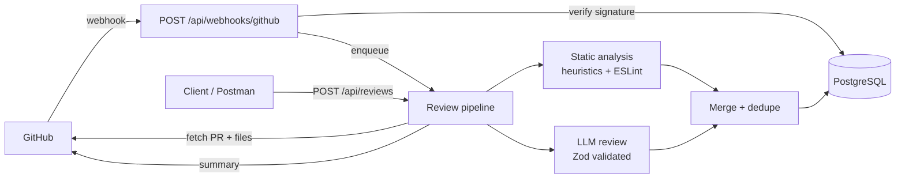

# PatchPilot API

AI-powered code review backend for open-source maintainers. PatchPilot reviews a
GitHub pull request, flags potential bugs, security issues, performance problems
and missing tests, suggests fixes, and publishes a review summary back to GitHub.

This repository contains the **backend only**. Authentication is intentionally out
of scope, so this initial version is for **local development or a trusted demo
environment** and must not be exposed as a public multi-user service.

---

## Features

- GitHub App integration (installation tokens, repository + PR access)
- Webhook receiver with HMAC-SHA256 verification and delivery idempotency
- In-process review pipeline with `QUEUED → RUNNING → COMPLETED | FAILED`
- Static analysis with ESLint on changed JavaScript/TypeScript files
- Heuristic scanners for secrets, injection patterns, TLS disabling, conflict
  markers, unsafe CI workflows and more
- Test-gap detection for source changes without test changes
- LLM review through one OpenAI-compatible provider, validated with Zod
- Deduplication of findings across static analysis and AI
- Suggested fixes (`suggestedFix`) returned with every finding
- Review summary publishing as a GitHub PR review (no approval/blocking)
- PostgreSQL persistence through Prisma with migrations
- Rate limiting, Helmet, CORS, request size limits, centralised errors
- Suggested fixes are never executed, committed, pushed or merged

---

## Tech stack

| Concern | Choice |
| --- | --- |
| Runtime | Node.js 22.5+ (ES modules, JavaScript) |
| HTTP | Express 5 |
| Database | PostgreSQL 17 (Docker Compose) |
| ORM | Prisma 6 |
| Validation | Zod |
| GitHub | `@octokit/rest` + `@octokit/auth-app` |
| Static analysis | ESLint 10 (Node API) |
| Security | Helmet, express-rate-limit, `node:crypto` |
| Tests | Node.js built-in test runner (`node:test`) |

---

## Architecture



The review job runs in-process and asynchronously. On startup, reviews left in
`QUEUED` or `RUNNING` from a previous crash are marked `FAILED`, because in-process
jobs cannot survive a restart.

---

## Project structure

```text
.
├── config/
│   ├── env.js                 # Zod-validated environment configuration
│   └── prisma.js              # Prisma client singleton
├── prisma/
│   ├── schema.prisma
│   └── migrations/
├── src/
│   ├── app.js                 # Express app (Helmet, CORS, JSON, rate limit)
│   ├── server.js              # Startup, interrupted-review reconciliation
│   ├── controllers/
│   │   ├── github.controller.js
│   │   ├── review.controller.js
│   │   └── webhook.controller.js
│   ├── middleware/
│   │   └── error.middleware.js
│   ├── routes/
│   │   ├── github.routes.js
│   │   ├── review.routes.js
│   │   └── webhook.routes.js
│   ├── services/
│   │   ├── github.service.js
│   │   ├── review.service.js
│   │   ├── analysis.service.js
│   │   └── ai.service.js
│   ├── scripts/
│   │   └── seed.js
│   ├── utils/
│   │   └── response.js
│   └── validators/
│       ├── github.validator.js
│       └── review.validator.js
├── tests/
├── docker-compose.yml
├── eslint.config.js
├── postman/
│   └── PatchPilot.postman_collection.json
├── .env.example
└── package.json
```

---

## Quick start

### Prerequisites

- Node.js 22.5 or newer
- Docker Desktop (or Docker Engine + Compose)
- A GitHub App if you want real pull-request reviews (optional for demos)

### 1. Install dependencies

```bash
npm install
```

### 2. Configure environment

```bash
cp .env.example .env
```

Set `POSTGRES_PORT` and `DATABASE_URL` to the same port. The example uses `5432`;
if that port is busy (common when another Postgres container is running), use
something like `5434` in both places.

### 3. Start PostgreSQL

```bash
docker compose up -d
docker compose ps
```

Wait for the container health check to report `healthy`.

### 4. Run migrations

```bash
npm run db:migrate       # creates prisma/migrations if needed
# or, in CI/deployment:
npm run db:migrate:deploy
```

### 5. Start the API

```bash
npm run dev
```

The API listens on `http://localhost:4000`.

### 6. Load demo data (optional)

```bash
npm run db:seed
```

This inserts a demo repository, pull request and a completed review with four
findings, without needing a GitHub App.

```bash
curl http://localhost:4000/api/reviews
curl http://localhost:4000/api/reviews/00000000-0000-4000-8000-000000000001
```

---

## Docker commands

| Task | Command |
| --- | --- |
| Start database | `docker compose up -d` |
| Stop database | `docker compose down` |
| Inspect status | `docker compose ps` |
| Database logs | `docker compose logs -f postgres` |
| Open `psql` | `docker compose exec postgres psql -U patchpilot -d patchpilot` |
| Reset schema only | `npm run db:reset` |
| Destroy all data (volume) | `docker compose down -v` |

The named volume is `pgdata`, so `docker compose down -v` deletes local data
permanently.

---

## Prisma commands

| Task | Command |
| --- | --- |
| Create + apply a migration | `npm run db:migrate -- --name change_name` |
| Apply migrations (production) | `npm run db:migrate:deploy` |
| Regenerate the client | `npm run db:generate` |
| Browse data | `npm run db:studio` |
| Reset database + migrations | `npm run db:reset` |

---

## GitHub App setup

1. Open **GitHub → Settings → Developer settings → GitHub Apps → New GitHub App**.
2. Set the webhook URL to your public endpoint, e.g.
   `https://your-subdomain.ngrok.app/api/webhooks/github` (use ngrok, Cloudflare
   Tunnel or `smee.io` while developing locally).
3. Set a **webhook secret** and put the same value in `GITHUB_WEBHOOK_SECRET`.
4. Repository permissions:
   - **Contents:** Read-only (needed to fetch changed file contents for ESLint)
   - **Pull requests:** Read and write (read the PR, post the review summary)
   - **Metadata:** Read-only (automatic)
5. Subscribe to events:
   - `Pull request`
   - `Installation`
   - `Installation repositories`
6. Generate and download a private key (`.pem`).
7. Install the app on your repository, then copy the installation id from the
   installation URL (`.../installations/12345678`) into `GITHUB_INSTALLATION_ID`.
8. Fill in `.env`:

```dotenv
GITHUB_APP_ID=123456
GITHUB_INSTALLATION_ID=12345678
GITHUB_APP_SLUG=your-app-slug
GITHUB_WEBHOOK_SECRET=your-webhook-secret
GITHUB_APP_PRIVATE_KEY_PATH=C:\path\to\your\github-app-private-key.pem
```
The app loads the private key from `GITHUB_APP_PRIVATE_KEY_PATH`. Paths may be
absolute or relative to the project directory. The inline
`GITHUB_APP_PRIVATE_KEY` option is still supported, but never commit `.env` or
the `.pem` file.

If the App lacks `pull_requests: write`, the review still completes and the
publishing error is stored separately in `summaryPublishError`; the review is
not marked failed.

---

## Environment variables

| Variable | Required | Default | Purpose |
| --- | --- | --- | --- |
| `NODE_ENV` | no | `development` | `development`, `production`, `test` |
| `PORT` | no | `4000` | HTTP port |
| `DATABASE_URL` | yes | example URL | PostgreSQL connection string |
| `POSTGRES_DB` | no | `patchpilot` | Compose database name |
| `POSTGRES_USER` | no | `patchpilot` | Compose database user |
| `POSTGRES_PASSWORD` | no | `patchpilot` | Compose database password |
| `POSTGRES_PORT` | no | `5432` | Host port mapped to Postgres |
| `FRONTEND_URL` | no | `http://localhost:3000` | Allowed CORS origin(s), comma separated |
| `GITHUB_APP_ID` | for GitHub | — | GitHub App id |
| `GITHUB_APP_PRIVATE_KEY` | for GitHub | — | App private key (PEM or `\n` escaped) |
| `GITHUB_WEBHOOK_SECRET` | for GitHub | — | HMAC secret for webhooks |
| `GITHUB_INSTALLATION_ID` | for GitHub | — | Installation id |
| `GITHUB_APP_SLUG` | no | `patchpilot` | Used by the install redirect |
| `LLM_API_KEY` | no | — | Enables AI review when set |
| `LLM_MODEL` | no | `gpt-4o-mini` | Model name |
| `LLM_BASE_URL` | no | `https://api.openai.com/v1` | OpenAI-compatible endpoint |
| `LLM_TIMEOUT_MS` | no | `60000` | AI request timeout |
| `LLM_MAX_DIFF_CHARS` | no | `120000` | Diff characters sent to the model |

Environment is validated with Zod at startup; invalid values stop the process.

---

## API reference

| Method | Path | Description |
| --- | --- | --- |
| `GET` | `/health` | Liveness + database check |
| `GET` | `/api/github/install` | Redirect to the GitHub App installation page |
| `GET` | `/api/github/repositories` | Repositories accessible to the installation |
| `GET` | `/api/github/repositories/:owner/:repo/pulls` | List pull requests |
| `GET` | `/api/github/repositories/:owner/:repo/pulls/:number` | Pull request details |
| `POST` | `/api/reviews` | Start a review (202 + review id) |
| `GET` | `/api/reviews` | Paginated review list |
| `GET` | `/api/reviews/:id` | Review details |
| `GET` | `/api/reviews/:id/findings` | Findings with evidence and suggested fixes |
| `GET` | `/api/reviews/:id/status` | Status + per-severity counts |
| `POST` | `/api/reviews/:id/publish` | Re-post the summary to GitHub |
| `POST` | `/api/webhooks/github` | GitHub webhook receiver |

### Start a review

```bash
curl -X POST http://localhost:4000/api/reviews \
  -H "Content-Type: application/json" \
  -d '{"owner":"octocat","repo":"hello-world","pullNumber":42}'
```

Response `202 Accepted`:

```json
{ "id": "3f8f0a52-6d2e-4a3e-9f5d-2a3c7b1e9d11" }
```

### Poll status

```bash
curl http://localhost:4000/api/reviews/<review-id>/status
```

```json
{
  "id": "3f8f0a52-...",
  "status": "COMPLETED",
  "summary": "PatchPilot reviewed ...",
  "findingCounts": { "CRITICAL": 1, "HIGH": 2, "MEDIUM": 1 }
}
```

### Findings

```bash
curl http://localhost:4000/api/reviews/<review-id>/findings
```

Each finding contains `title`, `description`, `severity`, `category`, `filePath`,
`startLine`, `endLine`, `evidence`, `suggestedFix` and `confidence`.

### Pagination and filters

```bash
curl "http://localhost:4000/api/reviews?limit=10&offset=0&status=COMPLETED"
```

`limit` is 1–100, `offset` is ≥ 0, and `repositoryId` can filter by repository.

### Publish a summary again

```bash
curl -X POST http://localhost:4000/api/reviews/<review-id>/publish
```

Publishing errors are returned as `{ "published": false, "error": "..." }` and do
not change the review status.

### Postman

Import `postman/PatchPilot.postman_collection.json` and set the `baseUrl`
variable (default `http://localhost:4000`). The collection contains every
endpoint above, including sample review-creation bodies.

---

## Review lifecycle

1. **Create** — `POST /api/reviews` fetches the PR and changed files, stores the
   repository and pull request, and creates a `QUEUED` review.
2. **Process** — the worker sets `RUNNING`, then:
   - caps the diff at 300 files / 600k characters
   - runs heuristics on added lines only
   - runs ESLint on changed JS/TS files and keeps diagnostics on added lines
   - checks for missing tests
   - calls the LLM when configured, with secrets masked
   - validates and deduplicates findings, then stores them
3. **Complete** — sets `COMPLETED` with a summary and attempts to publish a PR
   review summary when the GitHub App is configured.
4. **Fail** — any pipeline error sets `FAILED` with `errorMessage`; publishing
   errors never change the review status.

Duplicate webhooks are ignored via the unique `WebhookEvent.deliveryId`. A
`QUEUED` or `RUNNING` review for the same commit is reused rather than duplicated.

---

## Review engine

**Heuristics** run over added lines only:

- Cloud/API credentials (AWS, GitHub, Slack, Stripe) and generic credential
  assignments; matched values are redacted before storage and before reaching the LLM
- `eval`, `new Function`, shell interpolation, SQL concatenation, `innerHTML`,
  disabled TLS verification, weak hashes, `chmod 777`, unsafe Python calls
- Merge conflict markers, `debugger`, unpinned GitHub Actions,
  `pull_request_target` usage
- Missing tests when source files change without corresponding tests

**ESLint** is invoked through its Node API with an in-memory flat config. Only
diagnostics on added lines are reported. Repository code is parsed, never
executed.

**AI review** sends a size-limited diff to one OpenAI-compatible endpoint. The
system prompt treats the diff as untrusted input, secret values are masked, and
responses are parsed as JSON, validated with Zod, restricted to changed files,
checked against added line numbers, and required to include evidence. Invalid
responses degrade to static-analysis-only reviews.

**Deduplication** removes identical file/line/rule findings and resolves
static-vs-AI overlaps by keeping the more severe result.

The review summary explicitly states that it is not a guarantee that the code is
bug-free or secure.

---

## Testing

```bash
npm test
```

The suite uses the Node.js built-in test runner against a dedicated
`patchpilot_test` PostgreSQL schema. Ensure the database container is running.
Tests cover:

- webhook signature verification, missing headers, duplicate deliveries
- installation event persistence
- review creation, inline processing, completion and failure states
- queued-review reuse for the same commit
- Prisma relations, cascade deletes and unique constraints
- AI output validation, redaction, file/line filtering and confidence normalisation
- API validation, 404s and safe error responses
- summary publishing success and failure isolation

Run linting with:

```bash
npm run lint
```

Note: the test schema is created with `prisma db push`; it is isolated from the
development schema.

---

## Security notes

- No authentication, users or ownership. **Do not deploy publicly.**
- Webhook signatures are verified against the exact raw request body with a
  constant-time comparison.
- Private keys, installation tokens and full request headers are never logged.
- Secrets found in diffs are redacted before storage and before being sent to an
  LLM.
- Only changed lines are analyzed; AI file paths and line numbers are validated
  against the diff.
- No repository code is executed. ESLint parses source only.
- Suggested fixes are stored as text. They are never applied, committed, pushed
  or merged.
- Request bodies are capped at 1 MB; the review pipeline caps files, diff size
  and finding count; AI calls have a timeout.
- Errors in production responses do not include stack traces; GitHub errors are
  mapped to safe messages.
- Rate limiting (300 requests/minute per IP) applies to `/api/github` and
  `/api/reviews`, not to webhooks.

---

## Troubleshooting

| Symptom | Fix |
| --- | --- |
| `Port 5432 is already allocated` | Set `POSTGRES_PORT=5434` and update `DATABASE_URL` |
| `Can't reach database server` | `docker compose ps` and wait for `healthy` |
| `GitHub App is not configured` | Fill in `GITHUB_APP_ID`, private key, secret and installation id |
| `Invalid webhook signature` | The secret must match GitHub exactly; forward the raw body |
| Review stuck in `QUEUED` | Restart the server; interrupted reviews are marked `FAILED`, then re-run |
| AI findings missing | Check `LLM_API_KEY`; invalid or empty AI responses are discarded |
| `P1001` from Prisma | Postgres is not ready or `DATABASE_URL` port is wrong |

---

## Next: frontend

The backend exposes a stable JSON API (`/api/reviews`, `/api/reviews/:id/findings`,
`/api/reviews/:id/status`, `/api/github/*`). The planned next step is a dashboard
that lists repositories and reviews, shows findings grouped by severity with
evidence and suggested fixes, and lets a maintainer trigger a review.